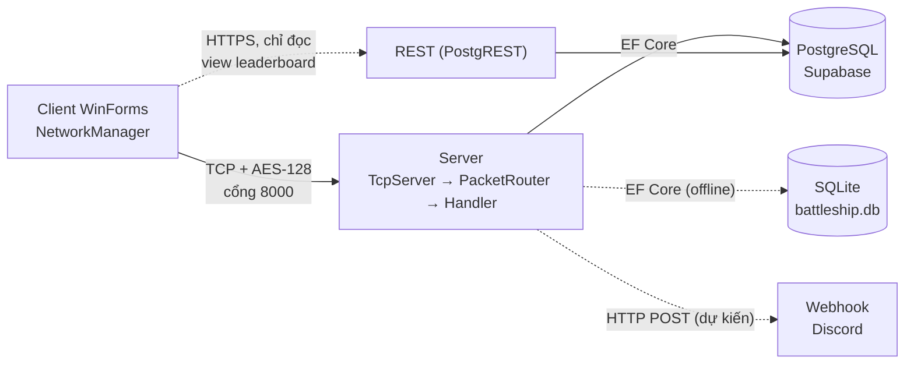
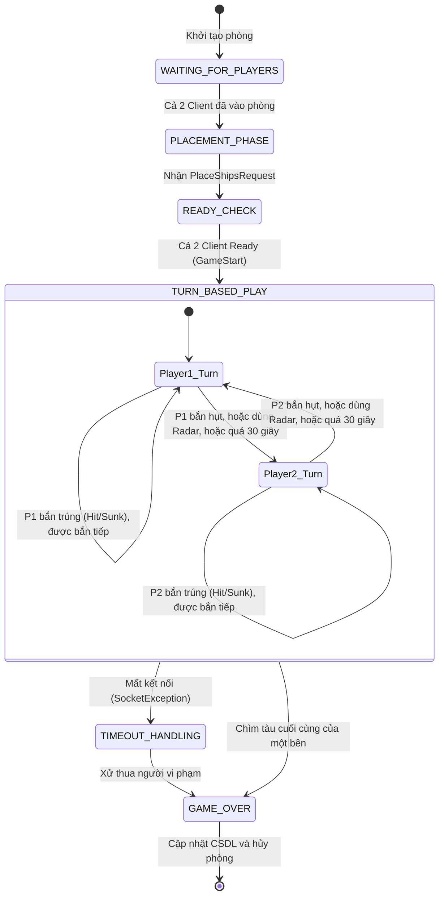

# NT106_Proj: Battleship Multiplayer

Đồ án môn **Lập trình mạng căn bản (NT106)**, UIT. Game Battleship (Bắn tàu) hai người chơi qua mạng, **tự cài giao thức trên TCP thô** bằng C# .NET 8.

| Thành viên | Phụ trách |
|---|---|
| Hoàng | Giao thức mạng, bảo mật, Supabase/REST, tích hợp |
| Đức | Server, phòng đấu, luật trận |
| Dũng | Giao diện WinForms, cơ sở dữ liệu |

## 1. Kiến trúc



- **Nét liền**: đường chính (TCP, cơ sở dữ liệu). **Nét đứt**: đường phụ hoặc chưa làm xong.
- Mỗi gói tin có dạng `[4 byte độ dài][AES(JSON{Type, Payload})]`. Gói đầu tiên là Handshake (kiểm tra phiên bản giao thức).
- **Server nắm luật**: Client chỉ gửi yêu cầu và hiển thị kết quả, không tự quyết Hit/Miss.
- Đăng nhập và chơi đi qua TCP. Client chỉ gọi REST để **đọc bảng xếp hạng**.

### Cấu trúc thư mục
| Thư mục | Nội dung |
|---|---|
| `Battleship.Shared/` | Giao thức dùng chung: `PacketType`, DTO, framing, handshake, AES |
| `Battleship.Server/` | TCP Server, `PacketRouter`, các handler (Auth, Room, Chat, Matchmaking), EF Core, bảo mật |
| `Battleship.Client/` | Giao diện WinForms, `NetworkManager` |
| `docs/` | Kế hoạch, hướng dẫn Supabase, quy trình demo, slide, timeline |

## 2. Cách khởi động hệ thống

### Yêu cầu
- **Windows** (Client là WinForms), **.NET 8 SDK** trở lên. Kiểm tra: `dotnet --version`.
- Git. Không cần cài cơ sở dữ liệu nếu chạy bằng SQLite.

### Bước 1: lấy code và build
```bash
git clone https://github.com/h2okisme57/NT106_Proj.git
cd NT106_Proj
git checkout main && git pull origin main
dotnet build BattleshipNetwork.slnx
```
Phải ra `0 Error(s)`.

### Bước 2: chạy Server (cửa sổ 1)
**Cách A: SQLite, chạy offline (khuyên dùng khi phát triển)**
```powershell
dotnet run --project Battleship.Server
```
Cửa sổ Server phải in `[DB] Đang dùng: SQLite (battleship.db)` rồi `Đang lắng nghe tại cổng 8000`. File `battleship.db` tự tạo ở thư mục chạy.

**Cách B: Supabase (cloud, dùng chung cả nhóm)**
```powershell
$env:BATTLESHIP_DB = "supabase"
$env:SUPABASE_DB_CONNECTION = "<chuỗi kết nối Session pooler, hỏi Hoàng>"
dotnet run --project Battleship.Server
```
Phải in `[DB] Đang dùng: Supabase (PostgreSQL)` và `Kết nối và kiểm tra bảng thành công`. Thiếu biến hoặc mất mạng thì Server báo lỗi và dừng; chuyển lại Cách A.

> **Chuỗi kết nối chứa mật khẩu cơ sở dữ liệu: tuyệt đối không commit lên Git, không gửi vào nhóm chat chung.** Chi tiết dựng Supabase: [docs/HuongDan_Supabase_WebService.md](docs/HuongDan_Supabase_WebService.md).

### Bước 3: chạy Client (cửa sổ 2, có thể mở thêm cửa sổ 3 để có hai người chơi)
```powershell
dotnet run --project Battleship.Client
```
Client luôn kết nối tới `127.0.0.1:8000`, nên Server phải chạy **trước** và cùng máy. Muốn chạy hai Client cùng lúc, mở thêm một cửa sổ terminal và chạy lại lệnh.

### Bước 4: thử nhanh
1. Ở màn đăng nhập bấm **Chưa có tài khoản?** để đăng ký, tạo hai tài khoản (ví dụ `demo01`, `demo02`).
2. Đăng nhập mỗi Client bằng một tài khoản. Vào được **Lobby** là thành công.
3. Chat ở sảnh, thử tạo phòng / vào phòng, hoặc cả hai bấm **Find Opponent** để ghép trận tự động.
4. Bấm **Leader Board** để xem bảng xếp hạng (cần mạng Internet).

### Các lỗi hay gặp
| Hiện tượng | Nguyên nhân và cách xử lý |
|---|---|
| Client báo "Không thể kết nối đến máy chủ" | Server chưa chạy, hoặc chạy sau Client. Chạy Server trước. |
| Server báo cổng 8000 đang bị dùng | Còn một Server cũ chưa tắt. Đóng nó (Ctrl+C) rồi chạy lại. |
| Đăng nhập sai 5 lần thì bị khóa | Đúng thiết kế: khóa 60 giây theo IP và theo tên. Đợi hết thời gian. |
| Đăng ký 5 lần liên tiếp bị chặn | Giới hạn 5 lần mỗi 10 phút mỗi IP. Đợi hoặc khởi động lại Server. |
| Server báo lỗi kết nối Supabase | Thiếu biến `SUPABASE_DB_CONNECTION` hoặc mất mạng. Dùng Cách A (SQLite). |
| Build báo lỗi file bị khóa | Còn một Client/Server đang chạy. Đóng hết rồi build lại. |

## 3. Tính năng và tiến độ

| Nhóm | Tính năng | Trạng thái |
|---|---|---|
| Tài khoản | Đăng ký, đăng nhập (BCrypt, khóa 5 lần sai), Online/Offline | Xong |
| Phòng | Tạo, vào, rời phòng bằng ID | Xong |
| Phòng | Kick thành viên (chủ phòng) | Dở dang (có hàm, chưa nối Router) |
| Ghép trận | Tìm trận ngẫu nhiên (Matchmaking) | Xong |
| Giao tiếp | Chat sảnh | Xong |
| Giao tiếp | Chat trong trận | Chưa |
| Gameplay | Xếp tàu, bắn theo lượt, sương mù, tự xử thắng | Chưa (Server chưa có logic trận) |
| Thống kê | Bảng xếp hạng (REST Supabase) | Xong |
| Thống kê | Lưu lịch sử đấu | Dở dang (có bảng, chưa ghi dữ liệu) |
| Bảo mật | AES-128-CBC, BCrypt, giới hạn đăng nhập và đăng ký | Xong |
| Đặc biệt | Radar 3x3, gửi kết quả trận ra Discord | Chưa (dự kiến 28/11 - 02/12) |
| Triển khai | Ngrok, chơi giữa hai mạng khác nhau | Chưa (Client đang gán cứng 127.0.0.1) |

Lịch chi tiết: [docs/Timeline_CapNhat_GiuaKy_final.xlsx](docs/Timeline_CapNhat_GiuaKy_final.xlsx). Mốc chính: đóng băng code **02/12**, sẵn sàng báo cáo từ **15/12/2026** (buổi học cuối 25/12/2026).

## 4. Vòng đời trận đấu (Server-Authoritative State Machine)

Server giữ toàn bộ bản đồ và chỉ báo kết quả Hit/Miss cho Client; không nhận lệnh bắn ngoài lượt.



### Luật chuyển lượt (đã chốt)
| Hành động | Kết quả từ Server | Lượt tiếp theo |
|---|---|---|
| Bắn tọa độ (X, Y) | Trúng (Hit) hoặc chìm (Sunk) | **Được bắn tiếp** (Server giữ nguyên `CurrentTurn`) |
| Bắn tọa độ (X, Y) | Hụt (Miss) | **Đổi lượt** sang đối thủ |
| Bắn chìm tàu cuối cùng của đối phương | Hết tàu | Chuyển thẳng sang `GAME_OVER` |
| Dùng **Radar** | Trả kết quả vùng quét 3x3 | **Mất 1 lượt**: đổi lượt ngay sau khi trả kết quả |
| Quá 30 giây mỗi lượt | Hết giờ lượt hiện tại | Tự động đổi lượt |
| Mất kết nối | Xử thua bên vi phạm | `GAME_OVER` |

Tên các trạng thái trong code (`RoomState`): `WaitingForPlayers`, `PlacementPhase`, `ReadyCheck`, `TurnBasedPlay`, `GameOver`.

Hiện đã có: `WaitingForPlayers` (tạo/vào phòng, ghép trận) và khung chuyển sang `PlacementPhase` khi đủ hai người. Từ `ReadyCheck` trở đi **đang phát triển** (xem timeline).

## 5. Bảo mật
| Lớp | Biện pháp |
|---|---|
| Đường truyền | AES-128-CBC, IV ngẫu nhiên mỗi gói |
| Mật khẩu | BCrypt (có salt), không bao giờ lưu mật khẩu rõ |
| Đăng nhập | Khóa 60 giây sau 5 lần sai (theo IP và theo tên); một tài khoản một phiên |
| Đăng ký | Tối đa 5 lần mỗi 10 phút mỗi IP |
| Phiên | Router chặn mọi gói (trừ đăng nhập, đăng ký) khi chưa đăng nhập |
| Dữ liệu | Supabase RLS; khóa công khai chỉ đọc được view `leaderboard` |

**Hạn chế đã biết:** khóa AES dùng chung, nằm trong ứng dụng, chưa trao đổi khóa khi kết nối. Hướng nâng cấp: TLS hoặc trao đổi khóa Diffie-Hellman.

## 6. Tài liệu
- [docs/QuyTrinh_Demo.md](docs/QuyTrinh_Demo.md): quy trình demo từng bước
- [docs/HuongDan_Supabase_WebService.md](docs/HuongDan_Supabase_WebService.md): dựng Supabase và REST
- [docs/KichBan_Thuyet_Trinh.md](docs/KichBan_Thuyet_Trinh.md): kịch bản thuyết trình
- [docs/slides/](docs/slides/): slide báo cáo (LaTeX, biên dịch bằng XeLaTeX)
- [docs/supabase_setup.sql](docs/supabase_setup.sql): SQL tạo bảng, view, RLS
